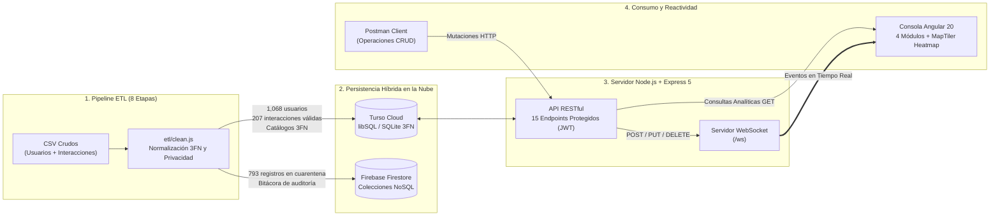

# Community 360 — Cloud Data Architecture & Real-Time Analytics Suite

<p align="left">
  <a href="https://community360-62t6.onrender.com" target="_blank">
    
  </a>
  
  
  
  
  
  
</p>

Plataforma integral de inteligencia y observabilidad para comunidades digitales multicanal (**Telegram, Discord, Facebook, Instagram, TikTok y Twitter/X**). Combina un pipeline **ETL de 8 etapas**, **persistencia híbrida en la nube** (**Turso SQL en 3FN** + **Google Cloud Firestore NoSQL**), una **API RESTful protegida con JWT**, sincronización reactiva mediante **WebSockets (`ws`)** y una consola analítica modular construida en **Angular 20** con cartografía térmica de **MapTiler Cloud + Leaflet Canvas**.

---

## 🌐 Demo en Producción

- **Aplicación Web (SPA Angular + API REST):** [https://community360-62t6.onrender.com](https://community360-62t6.onrender.com)
- **Canal WebSocket Seguro:** `wss://community360-62t6.onrender.com/ws`
- **Colección de Postman para Pruebas Reactivas:** [`docs/Community360.postman_collection.json`](./docs/Community360.postman_collection.json)

---

## 🏗️ Arquitectura del Sistema



### Pilares Arquitectónicos
1. **Persistencia Políglota (SQL + NoSQL):**
   - **Turso (`libSQL`):** Almacena el modelo relacional normalizado en **Tercera Forma Normal (3FN)**: `paises` → `estados` → `ciudades` → `usuarios` → `interacciones` → `interaccion_etiqueta` y `usuarios_auth`, eliminando dependencias transitivas y redundancia espacial.
   - **Google Cloud Firestore:** Resguarda documentos JSON de esquema flexible para las **793 interacciones en cuarentena** (huérfanas o fuera de catálogo) y la bitácora de corridas del ETL (`bitacora_etl`).
2. **Privacidad por Diseño (Privacy by Design):**
   - Los **171 usuarios** con `consentimiento_datos = 'no'` tienen sus atributos de localización (`id_ciudad`, `latitud`, `longitud`) estrictamente anulados desde el ETL y protegidos mediante una restricción `CHECK` en el motor SQL.
3. **Separación de Responsabilidades (REST vs. WebSockets):**
   - **API REST (`GET`):** Carga inicial, series históricas, agregaciones demográficas y filtrado paginado por segmentos.
   - **WebSockets (`ws`):** El dashboard opera en modo de monitoreo puro (sin formularios CRUD); cada operación `POST`, `PUT` o `DELETE` ejecutada desde Postman se propaga al instante a todos los navegadores conectados sin recargar la página.

---

## 🔌 Catálogo de Endpoints de la API REST (15 Rutas)

Todas las rutas analíticas y transaccionales están protegidas por el middleware `verificarAuth` (token JWT en header `Authorization: Bearer <token>` o cookie `httpOnly`).

| Método | Ruta | Descripción |
| :--- | :--- | :--- |
| `POST` | `/api/auth/login` | Autentica credenciales (`identificador`, `password`) contra Turso y emite un JWT de 8 h. |
| `POST` | `/api/auth/logout` | Cierra la sesión limpiando la cookie activa. |
| `GET` | `/api/auth/me` | Devuelve el perfil y rol del usuario autenticado. |
| `GET` | `/api/interacciones` | Lista interacciones paginadas (`limit`, `offset`) con filtros (`canal`, `tema`, `tipo`) y devuelve `resumen_segmento`. |
| `GET` | `/api/interacciones/:id` | Obtiene el detalle de una interacción con datos del autor (`JOIN usuarios`) y sus etiquetas. |
| `POST` | `/api/interacciones` | Crea una interacción validando catálogos e integridad referencial; emite `INTERACCION_CREADA` por WS. |
| `PUT` | `/api/interacciones/:id` | Actualiza campos permitidos y etiquetas; emite `INTERACCION_ACTUALIZADA` por WS. |
| `DELETE` | `/api/interacciones/:id` | Elimina la interacción y sus etiquetas asociadas; emite `INTERACCION_ELIMINADA` por WS. |
| `GET` | `/api/metricas/kpis` | Calcula `total_usuarios`, `usuarios_en_riesgo`, `total_interacciones` y `sentimiento_promedio`. |
| `GET` | `/api/metricas/por-canal` | Agrupa volumen de interacciones y sentimiento medio por plataforma. |
| `GET` | `/api/metricas/mapa-calor` | Genera la matriz cruzada de frecuencias entre los 6 canales y los 8 temas. |
| `GET` | `/api/metricas/sentimiento-tiempo` | Calcula la serie cronológica diaria de volumen y polaridad de sentimiento. |
| `GET` | `/api/metricas/geografia` | Distribución por país y top 10 ciudades filtrando exclusivamente `consentimiento_datos = 'si'`. |
| `GET` | `/api/metricas/usuarios-en-riesgo` | Lista paginada (`limit`, `offset`) de miembros en riesgo con filtros (`plataforma`, `prioridad`) y `resumen` del grupo. |
| `GET` | `/api/metricas/mapa-geografico` | Entrega las 793 coordenadas autorizadas, los 21 nodos urbanos y la configuración de teselas de MapTiler Cloud. |

---

## 📂 Estructura del Proyecto

```text
community360/
├── data/
│   ├── raw/                     # Datasets CSV originales sin depurar
│   └── clean/                   # Salida del ETL: CSV limpios (3FN), cuarentena.jsonl y bitacora.json
├── db/
│   ├── schema.sql               # Esquema relacional 3FN en SQLite/libSQL con FKs, índices y CHECKs
│   └── consultas_evidencia.sql  # Consultas analíticas de verificación
├── docs/
│   ├── fase1_modelado.md        # Documentación de modelado y arquitectura híbrida
│   └── Community360.postman_collection.json
├── etl/
│   ├── clean.js                 # Pipeline ETL de 8 etapas (sin dependencias externas)
│   ├── load.js                  # Carga idempotente hacia Turso (SQL) y Firestore (NoSQL)
│   └── verificar.js             # Verificación de conteos e invariantes de privacidad en la nube
├── frontend/                    # Código fuente de la SPA en Angular 20 (TypeScript + SCSS)
│   └── src/app/
│       ├── components/          # LoginComponent y DashboardComponent (4 módulos)
│       ├── guards/              # authGuard para protección de rutas
│       └── services/            # AuthService, ApiService, WebsocketService y ThemeService
├── public/                      # Build de producción de Angular servido por Express
├── scripts/
│   ├── sembrar_usuarios_auth.js # Semilla de usuarios autorizados con hashes bcrypt
│   └── generar_word.js          # Generador automatizado del reporte técnico en formato APA 7
├── server/
│   ├── app.js                   # Punto de entrada HTTP + Express + WebSockets + SPA fallback
│   ├── db.js                    # Cliente singleton de conexión a Turso (@libsql/client)
│   ├── ws.js                    # Servidor WebSocket (/ws) y difusión reactiva de métricas
│   ├── middleware/auth.js       # Middlewares verificarAuth y requerirRol
│   └── routes/                  # Controladores modulares: auth.js, interacciones.js, metricas.js
└── tests/                       # Suite de 21 pruebas automatizadas (ETL, Auth, REST y WebSockets)
```

---

## ⚙️ Instalación y Ejecución Local

### 1. Requisitos previos
- **Node.js** v18+ (recomendado v22 LTS)
- Cuenta e instancia en **Turso** (`libsql://...`)
- API Key gratuita de **MapTiler Cloud** ([https://cloud.maptiler.com/account/keys/](https://cloud.maptiler.com/account/keys/))

### 2. Configurar variables de entorno
Copia el archivo `.env.example` a `.env` en la raíz del proyecto y completa tus claves:

```env
TURSO_DATABASE_URL=libsql://tu-base-de-datos.turso.io
TURSO_AUTH_TOKEN=tu_token_de_turso
FIREBASE_SERVICE_ACCOUNT_FILE=C:/ruta/segura/firebase-clave.json
JWT_SECRET=tu_clave_secreta_jwt
PORT=3000
MAPTILER_API_KEY=tu_api_key_de_maptiler
```

### 3. Instalar dependencias y ejecutar

```bash
# Instalar dependencias del servidor
npm install

# (Opcional) Ejecutar pipeline ETL de limpieza y carga a la nube
npm run etl:clean
npm run etl:load

# (Opcional) Sembrar cuentas de acceso en Turso
npm run seed:auth

# Iniciar servidor Express + WebSockets + Frontend Angular en http://localhost:3000
npm start
```

Para recompilar el frontend Angular tras realizar cambios en `frontend/src/`:

```bash
npm run build:front
```

---

## 🧪 Pruebas Automatizadas

El proyecto incluye **21 pruebas automatizadas** con el runner nativo `node:test` que validan:
- **Fase 2 (`tests/clean.test.js` — 10 pruebas):** Estandarización de fechas, normalización 3FN, eliminación de ubicación sin consentimiento, cuarentena de usuarios inexistentes y deduplicación de etiquetas.
- **Fase 3 (`tests/auth.test.js` — 5 pruebas):** Hashing con `bcrypt`, firma/verificación de JWT y bloqueo de accesos sin token o sin rol administrativo.
- **Fase 4 (`tests/rest.test.js` — 5 pruebas):** Paginación de interacciones, cálculo de KPIs, validación de integridad referencial (`400`), ciclo completo CRUD (`POST → GET → PUT → DELETE`) y protección `401`.
- **Fase 5 (`tests/ws.test.js` — 1 prueba E2E):** Conexión WebSocket y recepción en tiempo real de `INTERACCION_CREADA`, `INTERACCION_ACTUALIZADA` e `INTERACCION_ELIMINADA`.

```bash
# Con el servidor activo en otra terminal (npm start):
npm test
```

---

## 👤 Autor

**César Andrés Ley Zapata**  
Ingeniería en Tecnologías de la Información e Innovación Digital — Grupo 7°B  
Universidad Tecnológica Metropolitana (Mérida, Yucatán, México)
