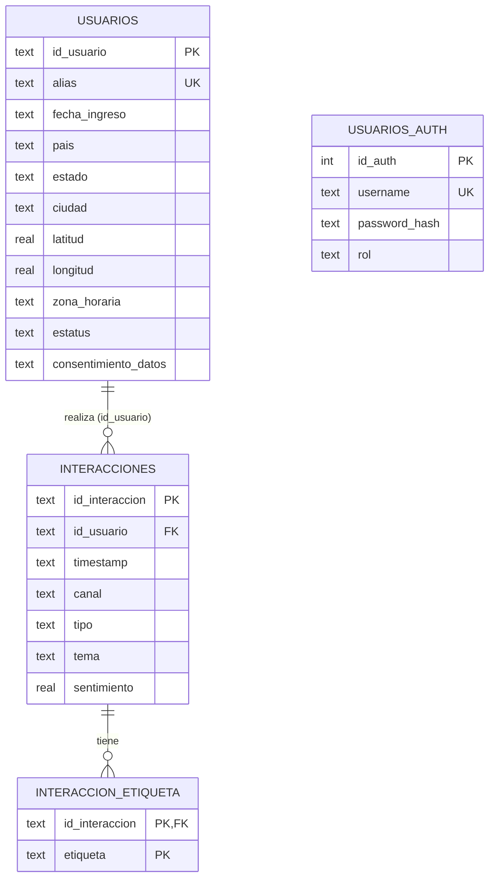

# COMMUNITY 360 — Fase 1: Análisis y modelado de datos

## 1. Inspección de los archivos

| Archivo | Registros | Clave | Observaciones |
|---|---|---|---|
| `comunidad_virtual_usuarios` | 1,068 | `id_usuario` (U000001–U001068) | Sin IDs ni alias duplicados. 171 usuarios (16 %) con `consentimiento_datos = "no"`; todos conservan país, estado, ciudad y zona horaria (las coordenadas ya venían vacías). 104 usuarios con consentimiento sin coordenadas. |
| `comunidad_virtual_interacciones_1000` | 1,000 | `id_interaccion` | Sin IDs duplicados. **793 (79.3 %) referencian un `id_usuario` inexistente** (614 IDs distintos, rango U001071–U005997, fuera del padrón). Nulos: `texto` 144, `etiquetas` 231, `pais/estado/ciudad` 173. |

**Hallazgos de calidad relevantes**

1. **Fechas con día y mes invertidos.** El `.xlsx` mezcla 636 fechas como texto `dd/mm/aaaa` (siempre con día > 12) y 432 como celdas de fecha (siempre con "día" ≤ 12). Es el patrón típico de Excel en configuración regional EE. UU. al abrir un CSV `dd/mm/aaaa`: las fechas ambiguas se convirtieron en `mm/dd`. Prueba: corrigiéndolo, `ultima_actividad ≥ fecha_ingreso` se cumple en el **100 %** de los usuarios y no hay fechas futuras; sin corregir, solo en 94.2 % y aparecen 26 fechas posteriores a hoy.
2. **Referencias rotas.** La integridad referencial no se cumple en 793 interacciones; se envían a cuarentena (no se eliminan).
3. **Geografía sin consentimiento.** Debe eliminarse en usuarios, y por criterio conservador también en los registros en cuarentena, donde el consentimiento no se puede verificar.
4. **Campo multivaluado:** `etiquetas` (`humor|musica|aviso`). `interes_principal` es de un solo valor, no multivaluado.
5. **Sin duplicados exactos** en los datos entregados; aun así el proceso los detecta (por id y por contenido) y los documenta si aparecen.

## 2. Diccionario de datos

### 2.1 `usuarios` (Turso)
| Campo | Tipo | Restricción | Descripción |
|---|---|---|---|
| id_usuario | TEXT | PK, formato `U######` | Identificador del miembro |
| alias | TEXT | NOT NULL, UNIQUE | Nombre público |
| fecha_ingreso | TEXT (aaaa-mm-dd) | NOT NULL | Alta en la comunidad |
| pais, estado, ciudad | TEXT | NULL si no hay consentimiento | Ubicación aproximada |
| latitud, longitud | REAL | rango geográfico; NULL si no hay consentimiento | Coordenadas |
| zona_horaria | TEXT | NULL si no hay consentimiento | Permite inferir ubicación, por eso se trata como dato geográfico |
| rango_edad | TEXT | `18-24`, `25-31`, `32-38`, `39+` | Segmento demográfico |
| especie_fursona | TEXT | — | Especie del personaje |
| interes_principal | TEXT | — | Interés dominante |
| plataforma_principal | TEXT | catálogo de 6 plataformas | Telegram, Facebook, TikTok, Instagram, Twitter/X, Discord |
| es_artista | INTEGER | 0 / 1 | Indicador booleano |
| mensajes_30d, reacciones_30d, eventos_asistidos, comisiones_compradas | INTEGER | ≥ 0 | Métricas de actividad |
| sentimiento_promedio | REAL | −1 a 1 | Sentimiento medio del usuario |
| ultima_actividad | TEXT (aaaa-mm-dd) | ≥ fecha_ingreso | Último movimiento |
| estatus | TEXT | `activo`, `en_riesgo`, `inactivo` | Estado de participación |
| consentimiento_datos | TEXT | `si` / `no` | Autorización para tratar ubicación |

### 2.2 `interacciones` (Turso)
| Campo | Tipo | Restricción | Descripción |
|---|---|---|---|
| id_interaccion | TEXT | PK, formato `I#######` | Identificador |
| id_usuario | TEXT | **FK → usuarios** | Autor de la interacción |
| timestamp | TEXT (ISO UTC) | NOT NULL | Momento |
| canal | TEXT | 6 valores | Plataforma de origen |
| tipo | TEXT | `mensaje`, `comentario`, `reaccion`, `respuesta_encuesta`, `rsvp_evento` | |
| texto | TEXT | NULL permitido (reacciones) | Contenido |
| tema | TEXT | 8 valores | `arte_comisiones`, `reglas_moderacion`, `eventos_convenciones`, `videojuegos`, `memes_humor`, `fursuits`, `seguridad_privacidad`, `musica` |
| sentimiento | REAL | −1 a 1 | |
| idioma, dispositivo | TEXT | — | |
| pais, estado, ciudad | TEXT | NULL si el usuario no consintió | |
| longitud_texto, reacciones_recibidas | INTEGER | ≥ 0 | |

### 2.3 `interaccion_etiqueta` (tabla puente, Turso)
`(id_interaccion FK, etiqueta)` con PK compuesta. Resuelve el atributo multivaluado `etiquetas`.

### 2.4 `usuarios_auth` (Turso)
`id_auth`, `username` UNIQUE, `password_hash`, `rol` (`admin`/`analista`), `creado_en`. Solo hash, nunca texto plano.

### 2.5 Colecciones Firestore
**`cuarentena`** — un documento por registro rechazado (id: `{run_id}_{entidad}_{id}`)
```json
{ "run_id": "run_20261118...", "entidad": "interacciones", "linea_origen": 4,
  "motivo": "usuario_inexistente", "detalle": "U002888",
  "geo_eliminada_por_privacidad": true,
  "payload": { "...campos originales, sin pais/estado/ciudad..." },
  "cargado_en": "<serverTimestamp>" }
```
**`bitacora_etl`** — un documento por corrida (id: `run_id`) con recibidos, aceptados, rechazados por motivo, transformaciones y métricas de calidad antes/después.

## 3. Modelo entidad-relación (SQL)


Cardinalidades: un usuario realiza 0..N interacciones; una interacción pertenece a exactamente 1 usuario y tiene 0..N etiquetas. `USUARIOS_AUTH` es independiente (credenciales del dashboard, no miembros de la comunidad).

## 4. Comparativa SQL vs NoSQL

| Criterio | SQL (relacional) | NoSQL (documental) | Aplicación al proyecto |
|---|---|---|---|
| Integridad referencial | Nativa (FK, CHECK) | Manual en la aplicación | Crítica: 793 referencias rotas. → SQL |
| Consultas analíticas | `GROUP BY`, JOIN, ventanas | Limitadas; suele requerir desnormalizar | Promedios, conteos, mapa de calor canal×tema. → SQL |
| Flexibilidad de esquema | Rígido (migraciones) | Alta | Registros rechazados con forma variable. → NoSQL |
| Escrituras | Transaccionales (ACID) | Rápidas, consistencia según el servicio | Altas/modificaciones/bajas de interacciones deben recalcular indicadores correctamente. → SQL |
| Escalabilidad | Vertical / réplicas de lectura | Horizontal | Volumen pequeño (miles de filas); no es determinante |
| Costo | Plan gratuito amplio | Plan gratuito amplio | Ambos dentro de límites |

## 5. Decisión y justificación técnica

**Arquitectura híbrida ligera: Turso (SQL) + Firestore (NoSQL).**

- **Turso** almacena las entidades del dominio. La relación 1:N por `id_usuario` y la exigencia de integridad referencial son un caso clásico relacional; además, el motor garantiza la privacidad mediante un `CHECK` (un usuario con `consentimiento_datos = 'no'` no puede tener ubicación) y las consultas del dashboard son agregaciones.
- **Firestore** almacena cuarentena y bitácora: datos de auditoría, solo de escritura, con estructura variable (cada rechazo conserva su payload original y un motivo distinto) y sin relaciones ni agregaciones.
- **No se usa un solo paradigma** porque forzar la cuarentena en tablas rígidas o las interacciones en documentos sacrifica justo lo que cada una necesita.
- **Servicios nuevos para el alumno:** Turso (libSQL/SQLite) y Firestore; no se repiten proveedores ni motores usados previamente.

**Costos y límites (consultar la página oficial antes de entregar):** Turso, plan gratuito (≈5 GB y 500 M filas leídas/mes); Firestore, plan gratuito (1 GB, 50 000 lecturas y 20 000 escrituras diarias). El volumen del proyecto (≈1 000 usuarios, ≈800 documentos de cuarentena) queda muy por debajo.

**Limitaciones reconocidas:** SQLite carece de tipo `DATE` y de arreglos (se usa texto ISO y tabla puente); la arquitectura híbrida duplica credenciales y conexiones; con este volumen no se aprovecha la escalabilidad horizontal de ninguno de los dos, y la decisión prioriza coherencia sobre escala.
